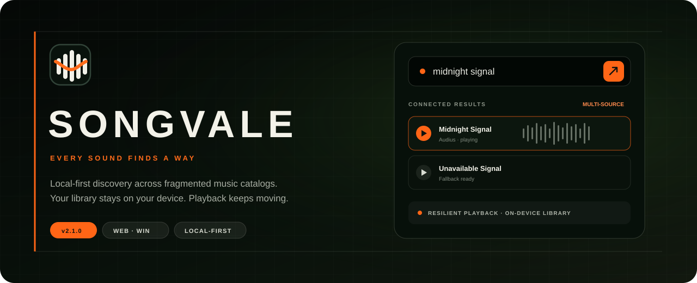
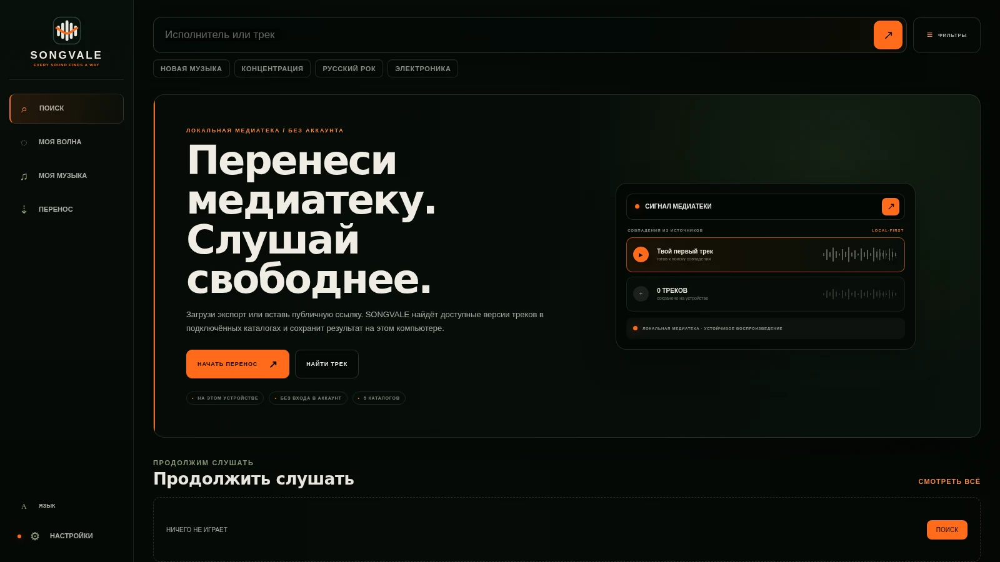

[English](README.md) · [Русский](README.ru.md)

# SongVale

A music player with an on-device library, a personal listening queue and search across connected catalogs.

[**Download for Windows**](https://github.com/Loro66/AWUN/releases/latest/download/SONGVALE-Setup-x64.exe) · [**Open web app**](https://awun-1.onrender.com) · [All releases](https://github.com/Loro66/AWUN/releases)

## What you can do

- Search connected YouTube, SoundCloud, Audius, Jamendo and Internet Archive sources. Availability depends on each provider and your region.
- Keep favorites, named playlists and a persistent queue on your device.
- Rate overall impression, melody, vocals, rhythm and atmosphere from 1 to 5; adjust the weight of each dimension.
- Build automatic preference collections with editable rating, artist and source rules.
- Discover music with continuous My Wave: choose a seed collection, artist separation and familiar/new balance.
- Import exported CSV, JSON, M3U or TXT collections and match their tracks.
- On Windows, use an always-on-top mini player, tray controls and optional global hotkeys.

## Install

| Platform | Available version |
| --- | --- |
| Windows | [Installer](https://github.com/Loro66/AWUN/releases/latest/download/SONGVALE-Setup-x64.exe) or [portable EXE](https://github.com/Loro66/AWUN/releases/latest/download/SONGVALE.exe). SHA-256 files are included in the release. |
| Web / PWA | [Open SongVale](https://awun-1.onrender.com); install from Chrome or Edge if desired. |
| iPhone | Open the web app in Safari and choose Share → Add to Home Screen. Native distribution requires Apple signing. |
| Android | Test builds are produced by GitHub Actions; a public store release still requires signing and store review. |

Windows beta builds are unsigned unless a signing certificate is configured. Search and streaming need internet; external catalog availability is not guaranteed.

## Release status

The published Windows release is **2.7.1**. Preview **2.8.0** is in [PR #64](https://github.com/Loro66/AWUN/pull/64) and has not been merged into the public release.

Preview features include artist and album pages, local audio, permitted offline copies, unified recording cards and continuous playback. Check the [changelog](CHANGELOG.md) and the relevant release before expecting a feature in your installed version.

## Build and contribute

See the [development guide](docs/DEVELOPMENT.md) for local setup, tests and Windows packaging.

[Report a bug](https://github.com/Loro66/AWUN/issues/new?template=bug_report.yml) · [Contributing](CONTRIBUTING.md) · [Documentation](docs/README.md) · [Support](SUPPORT.md)

## License and music sources

The current release is **proprietary, source-visible freeware**, as defined in [LICENSE.md](LICENSE.md) and [EULA.md](EULA.md). Publishing source code does not grant reuse rights beyond that license.

SongVale's code license does not grant rights to songs or provider services. YouTube uses the official visible player; provider permissions and download restrictions still apply.

Built by [Loro66](https://github.com/Loro66).
